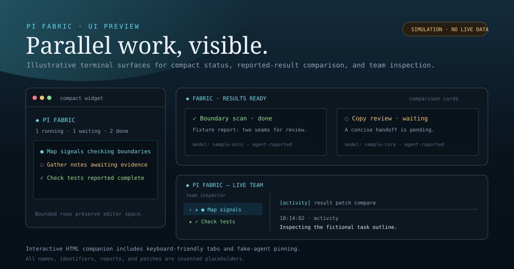

# Prasham Pi Extensions

**Parallel agents you can follow. Project context you do not have to repeat.**

A Git-installable collection of [Pi](https://github.com/earendil-works/pi-mono) extensions by [Prasham Trivedi](https://github.com/PrashamTrivedi). Fabric is the flagship: recursive agent teams with isolated Git worktrees and three live terminal views.



> The preview uses simulated, non-sensitive data. It is an illustration of the UI, not a recording of an agent run. Open [the interactive preview](https://PrashamTrivedi.github.io/Prasham-Pi-Extensions/preview.html), or run it locally with `npm run preview`.

## Install from Git

```sh
pi install git:github.com/PrashamTrivedi/Prasham-Pi-Extensions@v0.1.0
```

Run `/reload` inside an existing Pi session. Requires a recent Pi with the `@earendil-works` extension APIs; development targets **Pi 0.85.1** and Node **22.19+**. Fabric additionally requires Git, a repository with at least one commit, a `pi` executable on PATH, and authenticated model access. Shell-oriented context helpers are intended for macOS/Linux.

Install for a project instead:

```sh
pi install -l git:github.com/PrashamTrivedi/Prasham-Pi-Extensions@v0.1.0
```

Use `pi config` to disable individual extensions. To install only Fabric, use this package entry in `~/.pi/agent/settings.json`:

```json
{
  "packages": [
    {
      "source": "git:github.com/PrashamTrivedi/Prasham-Pi-Extensions@v0.1.0",
      "extensions": ["extensions/fabric/index.ts"]
    }
  ]
}
```

Merge that entry into your existing settings; do not replace unrelated configuration.

## What's inside

| Extension | What it does | Controls |
| --- | --- | --- |
| **Fabric** | Recursive agent teams, worktree isolation, live activity, comparisons, and inspection | `/team`, four agent tools |
| **Project context** | Adds the working directory and a bounded directory tree to the system prompt | `PI_TREE_DEPTH`, `PI_TREE_MAX` |
| **Recursive context** | Loads nested `AGENTS.md` / `CLAUDE.md` in trusted projects | `PI_RECURSIVE_CONTEXT_MAX`, `PI_RECURSIVE_CONTEXT_NAMES` |
| **Cloudflare AI usage** | Estimates locally observed Workers AI token usage and optionally fetches billing data | `/cf-ai-usage`, external config |
| **Skill-name sanitizer** | Previews and optionally corrects invalid skill frontmatter names | `/sanitize-skills`, `/sanitize-skills apply` |

The herdr-generated integration is intentionally not redistributed. Install herdr's own integration separately.

## Fabric: delegate without losing the thread

Ask Pi naturally:

> Explore two approaches to this issue in parallel. Use Fabric where useful, compare the evidence, and do not apply patches without reviewing them.

The model decides whether delegation is useful. Fabric supplies the execution tools, not a mandatory workflow.

### 1. Compact live widget

A small panel above the editor prioritizes unfinished work and shows each agent's latest activity. It refreshes without taking keyboard focus. Hide it with `/team hide`; bring it back with `/team show`. Hiding the panel does not stop workers.

### 2. Comparison cards in the conversation

While `await_agents` runs, cards update with reported findings. Wide terminals show two cards side by side; narrow terminals stack them. Expand the tool output for additional agents and detail. Finished workers also produce persistent transcript cards without adding UI telemetry to the parent model's context.

### 3. Framed team inspector

Open `/team` for an accented, shaded overlay distinct from the chat behind it.

| Key | Action |
| --- | --- |
| `↑` / `↓`, `j` / `k` | Select an agent |
| `Tab` / `Shift-Tab`, `←` / `→` | Switch Team, Activity, Tools, Result, Patch, Compare tabs |
| `p` | Pin or unpin an agent; pin two for comparison |
| `PageUp` / `PageDown` | Scroll details |
| `Esc` | Close the inspector; workers keep running |

`/team status` refreshes the summary. `/team cancel <full-agent-id>` cancels a worker and its descendants. Cancellation preserves worktrees for review. The overlay covers part of chat; it is not a docked split-pane layout.

### Agent tools

- `spawn_agents`: queue independently useful tasks on selected models.
- `await_agents`: wait for direct children, releasing a waiting worker's active slot.
- `agent_status`: inspect the tree and optional results.
- `cancel_agents`: cancel a subtree.

Each worker is a separate Pi process. Delegation uses the **same model or a lower-ranked configured model**. No task timeout or turn cap is imposed; concurrency is bounded by the configured active-agent count. Model calls can incur costs. Review patches and rerun tests before integrating anything.

### Configuration

Keep personal configuration **outside the installed Git checkout**. See [examples/fabric.config.json](examples/fabric.config.json) and [the Fabric configuration guide](docs/fabric.md). Model IDs in examples are placeholders, not bundled model access or subscriptions.

```sh
mkdir -p ~/.pi/agent
# After cloning this repository; edit the model IDs before use:
cp examples/fabric.config.json ~/.pi/agent/pi-fabric.config.json
```

`PI_FABRIC_CONFIG` can point at a different configuration file. Configuration changes apply to new Fabric roots; existing runs retain their configuration snapshot. The live UI reconnects to a run after `/reload` when its reference is saved in the Pi session.

Results, patches, activity snapshots, and worktrees live under the system temporary directory, in `pi-fabric/<root-id>/`. They are local—not uploaded by the preview or package. Temporary storage is not a backup. Remove worktrees through Git after reviewing or discarding their changes; deleting directories alone leaves worktree metadata behind.

### Important boundaries

- A Git worktree prevents accidental checkout collisions; **it is not an OS sandbox**.
- Workers can access the host filesystem, network, and inherited credentials.
- Findings are agent-reported, not independently verified facts.
- Fabric does not automatically merge patches or implement a peer-to-peer debate protocol.
- Telemetry captures public assistant messages and tool metadata, not private thinking. Tool arguments are not streamed into the UI; public results can still contain sensitive data.
- Review the [security notes](SECURITY.md) before installing.

## Other extension configuration

### Project context

| Variable | Default | Meaning |
| --- | --- | --- |
| `PI_TREE_DEPTH` | `2` | Directory depth |
| `PI_TREE_MAX` | `8000` | Maximum tree characters |

Uses `tree` when available, with a `find` fallback. Context is cached until session start/reload or a working-directory change. File names are included in model context; file contents are not read by this extension.

### Recursive context

| Variable | Default | Meaning |
| --- | --- | --- |
| `PI_RECURSIVE_CONTEXT_MAX` | `200000` | Maximum injected characters |
| `PI_RECURSIVE_CONTEXT_NAMES` | `CLAUDE.md,AGENTS.md` | File names in precedence order |

Only files below the working directory are added, avoiding root/ancestor duplication with Pi's loader. Git discovery respects ignored untracked files; tracked files remain eligible. Non-Git fallback ignore support is intentionally limited. This eagerly loads nested instructions—it is not path-scoped lazy loading. Disable it if you want smaller prompts or stricter instruction scoping.

### Cloudflare AI usage

No credentials or personal billing configuration are shipped. Without configured rates, the extension does not fetch billing data or record usage estimates.

Copy [examples/cloudflare-ai-usage.config.json](examples/cloudflare-ai-usage.config.json) to `~/.pi/agent/cloudflare-ai-usage.config.json`, or set `PI_CF_AI_USAGE_CONFIG`. Supply current rates for the models you use. Example figures are illustrative inputs and are **not a promise of current Cloudflare pricing**.

Optional billing lookup reads the environment variables named in that file (by default `CLOUDFLARE_ACCOUNT_ID` and `CLOUDFLARE_BILLING_TOKEN`). Use a least-privilege token with appropriate billing-read access. Never commit tokens. Local records are saved to `~/.pi/agent/state/cloudflare-ai-usage.jsonl`.

Estimates reflect messages seen by this installation, not all account traffic. Billing API availability, permissions, reporting delays, and units can vary; the Cloudflare dashboard is authoritative. This is not a billing meter or spending cap.

### Skill-name sanitizer

```text
/sanitize-skills          # preview only
/sanitize-skills apply    # confirm before changing SKILL.md files
```

Scans `~/.agents/skills` and `~/.pi/agent/skills`. The package does not rewrite skills at startup. Back up third-party skills before applying changes. A standalone dry-run is also available:

```sh
bun run extensions/sanitize-skill-names.ts
bun run extensions/sanitize-skill-names.ts --apply
```

## Migrating from loose extension files

1. Finish any running Fabric workers.
2. Back up your existing extensions and configuration.
3. Move personal Fabric and Cloudflare configuration to the external paths described above.
4. Move the old copies of these five extensions **outside** Pi's auto-discovery directories. Do not leave a second `pi-fabric/index.ts` under `~/.pi/agent/extensions/`.
5. Install this package, then `/reload`.

This prevents duplicate tool registrations and repeated prompt injection. Do not remove unrelated extensions such as herdr's integration. Package updates never intentionally modify your personal settings or migrate loose files automatically.

## Updates and removal

Pinned tags do not automatically advance to newer releases. To upgrade, install the new tag explicitly:

```sh
pi install git:github.com/PrashamTrivedi/Prasham-Pi-Extensions@NEW_VERSION
```

For an unpinned development checkout, install without `@v0.1.0` and update with `pi update --extensions`. Git updates may reset and clean the package checkout—never store personal configuration there.

```sh
pi remove git:github.com/PrashamTrivedi/Prasham-Pi-Extensions
```

Reload Pi after removal. User configuration and agent artifacts are retained for deliberate cleanup.

## Development

```sh
git clone https://github.com/PrashamTrivedi/Prasham-Pi-Extensions.git
cd Prasham-Pi-Extensions
npm ci
npm run check                 # TypeScript, Bun tests, package validation
npm run preview               # http://127.0.0.1:4173
```

Install [Bun](https://bun.sh) for tests. Extensions are TypeScript loaded directly by Pi; no production build step is required. Core Pi packages are peer dependencies, not vendored copies. CI uses Node 24 and Bun.

The HTML preview works offline and uses simulated data; it never starts workers or asks for API credentials. Source lives in `extensions/`, tests in `tests/`, previews and guides in `docs/`.

## License

A license has not yet been selected. The package is marked `UNLICENSED`; public availability does not grant an open-source redistribution license. Do not assume MIT or another license until the repository owner adds one.
